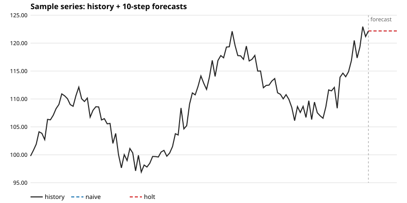

# Stock Price Forecaster

A stock price forecasting toolkit in R: time-series models, honest
backtesting, and forecast evaluation — built to be read, run, and
compared, not just fitted.

## Roadmap

- [x] Project scaffold (README roadmap, baseline models, smoke test, CI)
- [x] Data loading: CSV price series + validation
- [x] Models: naive, moving average, SES/Holt smoothing, AR/ARIMA(p,d,0)
- [x] Backtesting: rolling-origin evaluation
- [x] Metrics: MAE, RMSE, MAPE, directional accuracy
- [x] Forecast plots (standalone SVG, no packages)
- [x] Forecast report (Markdown: series summary, forecasts, backtest ranking)
- [ ] Self-review checklist, then public

## Quick start

```sh
Rscript tests/run_all.R     # full test suite (base R only, no packages)
Rscript examples/compare.R  # every model forecasting the sample series
Rscript examples/backtest.R # every model backtested, ranked by RMSE
```

## Data loading

```r
source("R/data.R")
prices <- load_prices("data/sample-prices.csv")  # date, close
```

`load_prices()` requires `date` (YYYY-MM-DD) and `close` columns,
rejects missing files, missing columns, unparseable dates, non-numeric
or non-finite closes, and duplicate dates, and returns rows sorted by
date. `data/sample-prices.csv` is a bundled 120-day synthetic series,
regenerable with `python3 examples/make_sample.py` (seeded).

## Models

All models take a numeric price vector (oldest first) and return `h`
forecasts; `forecast_price(x, h, method, ...)` dispatches to any of them.

| Method | Function | Notes |
| --- | --- | --- |
| `naive` | `naive_forecast(x, h)` | Repeats the last price. |
| `mean` | `mean_forecast(x, h)` | Repeats the series mean. |
| `ma` | `ma_forecast(x, h, window = 5)` | Repeats the last trailing mean. |
| `ses` | `ses_forecast(x, h, alpha = NULL)` | Simple exponential smoothing; `alpha` grid-searched when omitted. |
| `holt` | `holt_forecast(x, h, alpha = NULL, beta = NULL)` | Holt linear trend; parameters grid-searched when omitted. |
| `ar` | `ar_forecast(x, h, p = 1, d = 0)` | AR(p) fitted by OLS on lagged values. |
| `arima` | `arima_forecast(x, h, order = c(p, d, 0))` | ARIMA(p, d, 0); MA terms (q > 0) are not supported. |

## Backtesting

`rolling_origin(x, h, initial, step, method, ...)` runs an
expanding-window backtest: each fold trains on `x[1:origin]` and
forecasts the next `h` values, with origins advancing by `step` from
`initial`. Only complete folds are kept. `evaluate_backtest()` scores
the result overall and per horizon step (error usually grows with
horizon, and the breakdown shows it).

Directional accuracy is computed fold-aware: horizon 1 compares against
the fold's last training value, later steps against the previous step
*within the same fold* — pooling rows naively would compare a fold's
first step against the previous fold's last step, which never happened.

```r
source("R/backtest.R")
bt <- rolling_origin(x, h = 5, initial = 90, step = 5, "holt")
evaluate_backtest(bt)$overall
```

On the bundled sample series (`Rscript examples/backtest.R`, h = 5,
initial = 90, step = 5), naive wins on RMSE (2.45) but scores 0.00
directional accuracy — it never predicts a move, so it is right on
magnitude and wrong on direction. Holt is a close second on RMSE
(2.51) with 0.63 directional accuracy. One metric never tells the
whole story; the backtest table reports both.

## Metrics

`R/metrics.R` scores one forecast against actuals:

| Function | Meaning |
| --- | --- |
| `mae(actual, forecast)` | Mean absolute error. |
| `rmse(actual, forecast)` | Root mean squared error (penalises large misses). |
| `mape(actual, forecast)` | Mean absolute percentage error as a fraction; errors when any actual is zero, since MAPE is undefined there. |
| `directional_accuracy(actual, forecast, last)` | Fraction of steps where the forecast moves the same way as the actual, relative to `last`. A flat step is its own direction, so flat forecasts on moving series get no free credit. |
| `evaluate_forecast(actual, forecast, last = NULL)` | All of the above as one row (directional accuracy is `NA` without `last`). |

## Forecast plots

`R/plot.R` renders history + forecasts as a standalone SVG file — no
graphics device, no packages — so plots work in CI and can be embedded
in reports and READMEs. History is solid, forecasts are dashed and
continue from the last observed point, with a divider at the forecast
origin.

```r
source("R/plot.R")
write_forecast_svg("docs/forecast-plot.svg", x,
                   list(naive = naive_forecast(x, 10),
                        holt = holt_forecast(x, 10)))
```

Run `Rscript examples/plot.R` to regenerate the sample chart:



## Forecast reports

`R/report.R` builds a Markdown report: series summary, one forecast
row per method with a column per horizon step, and — when backtest
results are supplied — an RMSE-ranked backtest table naming the best
method. Run `Rscript examples/report.R` to regenerate the sample
report at [docs/forecast-report.md](docs/forecast-report.md).

```r
source("R/report.R")
write_forecast_report("docs/forecast-report.md", x, forecasts, backtest)
```

On the sample series the report is honest about the headline result:
naive wins on RMSE at h = 10 but scores 0.00 directional accuracy —
it never predicts a move — while Holt is effectively tied on RMSE
with 0.60 directional accuracy.

## Baseline models

`R/baseline.R` provides the two simplest forecasts, which every fancier
model must beat to earn its place:

- `naive_forecast(x, h)` — repeats the last observed price `h` steps.
- `mean_forecast(x, h)` — repeats the mean of the observed prices.

Both take a numeric vector of prices and return a numeric vector of
length `h`.

## License

MIT — see [LICENSE](LICENSE).
